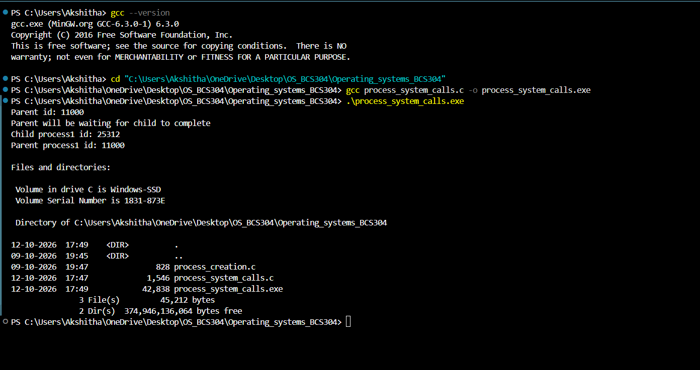
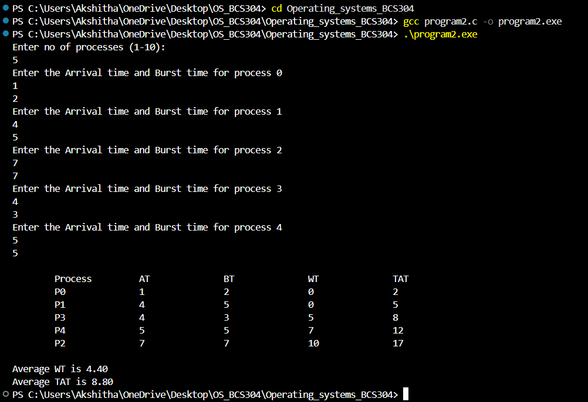
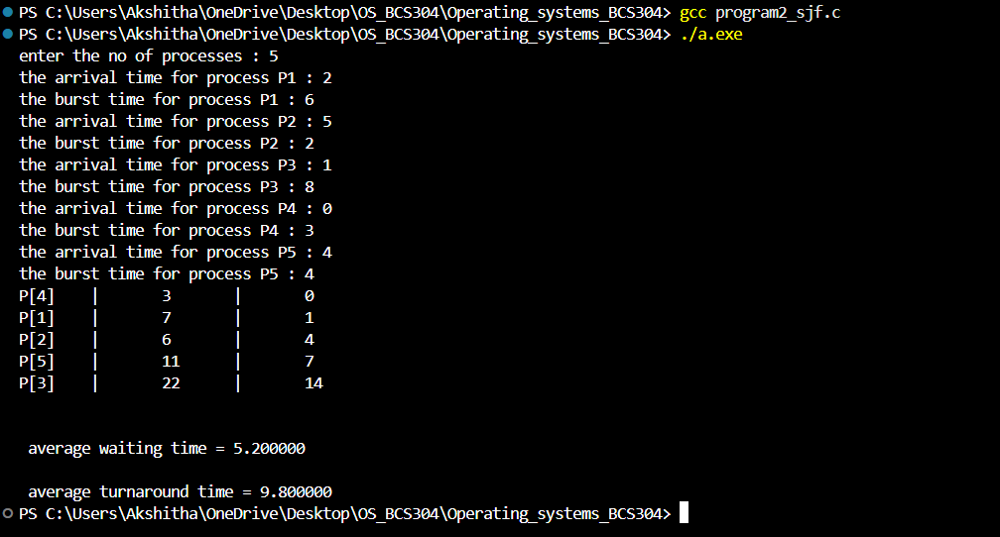
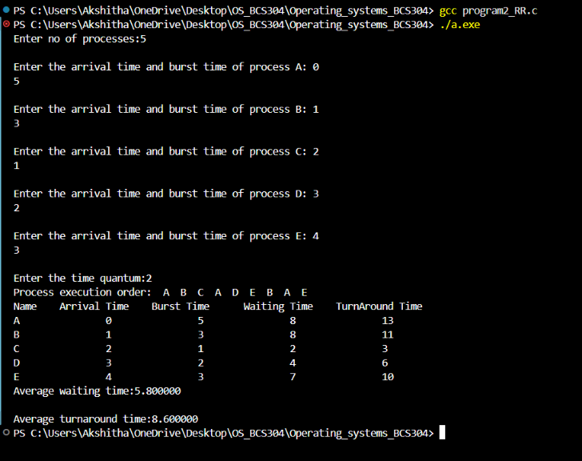
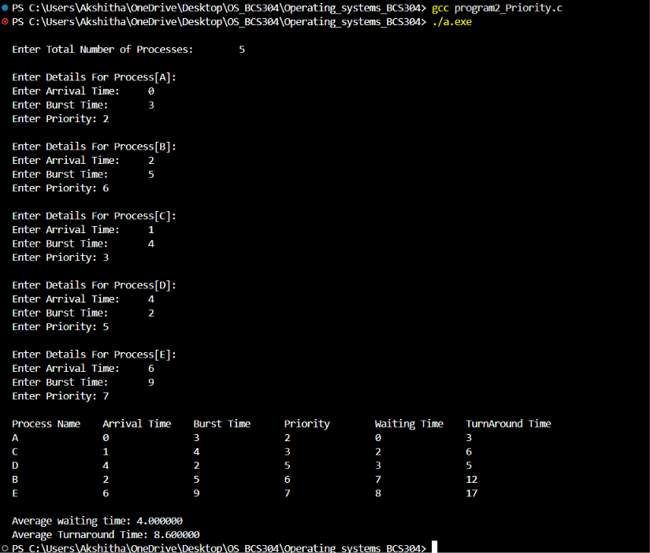

Program 1:
Develop a C Program to Implement the process System call(fork(), exec(), wait(), create process, terminate process)
## Output

Program 2.a:
Simulate the following  CPU scheduling algorithms to find turnaround time and waiting time:  a) FCFS  b) SJF c) Round Robin d) Priority. 

### Output

program2.b:
Simulate the following  CPU scheduling algorithms to find turnaround time and waiting time: b) SJF 
## SJF Program Output

program 2.c:
Simulate the following  CPU scheduling algorithms to find turnaround time and waiting time: c)round robin
##output

program 2.d:
Simulate the following  CPU scheduling algorithms to find turnaround time and waiting time: d)priority
##output

